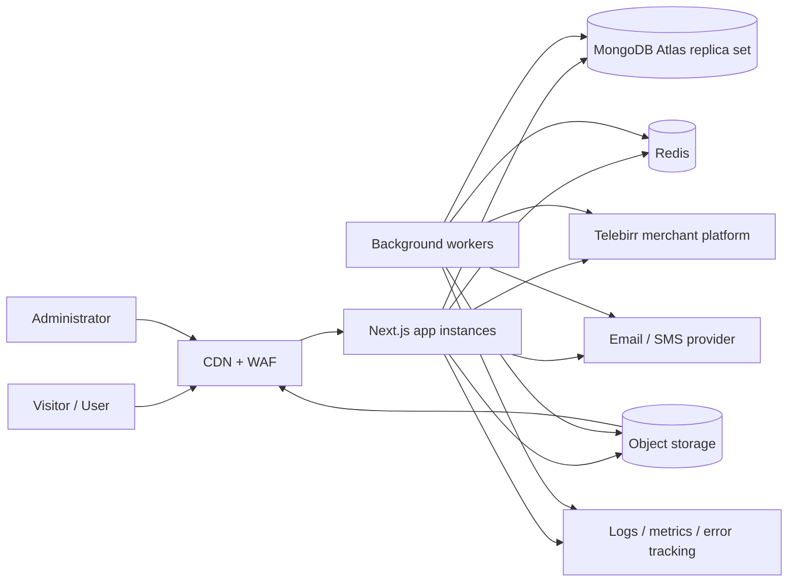

# Architecture — Lucky Travel Ethiopia

| Field | Value |
| --- | --- |
| Status | Draft for Phase 1 review |
| Version | 0.1 |
| Date | 2026-10-23 |
| Baseline | Next.js 16.4.2, React 19.3.0, TypeScript 5 strict, Tailwind CSS 4 |
| Next phase | Phase 2 — foundation, design system and i18n infrastructure |

## 1. Purpose and scope

Lucky Travel Ethiopia is a bilingual tourism discovery and paid travel-plan platform with administrator-managed content, server-calculated pricing, a Telebirr payment abstraction, and a separately auditable participant-selection workflow.

This document defines the target architecture for all 13 phases. It is deliberately explicit about what is **not** implemented yet. The repository currently contains the Create Next App starter only:

- No MongoDB connection, models, migrations or seeds.
- No authentication, sessions, roles or rate limiting.
- No destination, plan, order, payment or selection functionality.
- No tests, CI, object storage, workers or deployment configuration.
- No production destination data, prices or legal copy.

Phase 1 does not implement those features. The purpose of this gate is to agree the shape of the system before code is layered on top of it.

## 2. Current repository baseline (inspected)

| Area | Current state |
| --- | --- |
| Framework | Next.js `16.4.2`, App Router at repository-root `app/` |
| React | `19.3.0` |
| TypeScript | `^5`, `strict: true`, `@/*` mapped to project root |
| Styling | Tailwind CSS `^4` through `@tailwindcss/turbopack` |
| Lint | ESLint 9 flat config with `eslint-config-next` core-web-vitals and TypeScript rules |
| Next features | `cacheComponents: true`, `partialPrefetching: true`, `experimental.agentFeedback: true`, Turbopack CSS rule |
| Runtime verified | Node `24.21.0`, npm `11.19.0` |
| Existing UI | Starter `app/layout.tsx` and `app/page.tsx`; Geist fonts; no brand implementation |
| Other config | No `.env` committed; `.gitignore` excludes `.env*`; no test or deployment config |
| Git | Clean baseline commit `50327a0 Initial commit from Create Next App` |

### Next.js 16 constraints that shape this design

1. **Cache Components is already enabled.** Prerendering and runtime boundary rules apply. Session reads (`cookies()`) must sit behind a `<Suspense>` boundary (or use `use cache: private`), and public content should be cached explicitly with `use cache`, `cacheLife` and `cacheTag`.
2. **Middleware is now `proxy.ts`.** It is used only for locale negotiation and safe redirects. It is **not** the authorization layer. Every page, Server Action and Route Handler performs its own server-side authorization.
3. **Server Actions enforce Origin checks**, but are still directly reachable POST endpoints. Every action validates input and authorization, constrains return values, and does not rely on a hidden UI control.
4. **Route Handlers are used for streamed/live data, provider callbacks, uploads and health**, not for ordinary first-party form mutations.
5. The project must not use the old Pages Router patterns, `middleware.ts`, `experimental.ppr` or `runtime = 'edge'` with the current Cache Components configuration.
6. Before writing implementation code, the relevant local guide under `node_modules/next/dist/docs/` is consulted, per `AGENTS.md`.

## 3. Architectural principles

1. **Server-authoritative business logic.** Prices, totals, eligibility, roles, payment state and selection results are computed and persisted on the server. Client input is a request, never a fact.
2. **Bilingual by construction.** Every administrator-managed public content item stores English and Amharic values. Public publishing requires both. No component duplicates translation logic.
3. **Immutable evidence.** Orders, successful payment transactions, selection snapshots, results and audit records are append-only or versioned. Edits create new versions with an audit trail.
4. **Least privilege and deny-by-default.** Public, user and administrator surfaces use separate layouts and service guards. Object ownership is checked, not inferred from a URL.
5. **No invented integrations or data.** Telebirr endpoints/keys/signatures remain blank until official merchant documentation is supplied. Destination prices/hours are administrator-entered and verified; demo data is labelled.
6. **Fail closed for money and selection.** Missing configuration, an unsupported provider, a missing legal approval or an unavailable replica set blocks activation rather than silently degrading.
7. **Accessible by default.** Keyboard navigation, focus management, reduced-motion alternatives, semantic HTML and readable bilingual typography are acceptance criteria, not polish at the end.
8. **Measured capacity.** One million registered accounts is a data-volume target, not a claim of one million concurrent users. Capacity is measured in Phase 12.
9. **Boring, observable operations.** Stateless app instances, managed data services, idempotent jobs, request IDs, structured logs and documented recovery.
10. **No feature without tests.** Business-rule or security-boundary changes add unit/integration/E2E coverage in the same phase.

## 4. System context



### Trust boundaries

| Boundary | Rule |
| --- | --- |
| Browser → application | All input is untrusted; validate shape, type, length, ownership and business rules on the server. |
| Application → MongoDB | Parameterized Mongoose queries; explicit field projections; transactions for state transitions. |
| Application → Telebirr | Server-to-server only; credentials in the secret store; responses verified against the provider, never trusted because a browser redirected back. |
| Provider → callback | Signature/authenticated-response verification, replay protection, idempotency and independent status verification. |
| Application → object storage | Server-issued, short-lived signed uploads; file type verified by content, not name; images re-encoded. |
| Administrator → high-impact action | Re-authentication, MFA, permission check, audit record and second-person approval where specified. |
| Public viewer → selection display | Read-only. No public request can start, change or reveal the authoritative result. |

## 5. Runtime topology

### 5.1 Application process

A long-lived Next.js Node.js process is preferred over per-request serverless execution for the primary deployment because it:

- supports ordinary MongoDB connection pooling;
- supports SSE for live selection-status updates;
- avoids reconnection storms against Atlas;
- is straightforward to run behind a load balancer/CDN with rolling deployments.

The app remains stateless: no in-memory authoritative queues, locks, participant lists or payment ledgers.

### 5.2 Worker process

A separate Node process runs BullMQ workers for:

- payment verification/reconciliation and refund reconciliation;
- notification delivery and retries;
- snapshot building and selection-event jobs;
- media post-processing if not completed inline;
- periodic cleanup of expired sessions/tokens and stale pending orders.

Workers use the same service layer as the web app. They never re-implement business rules.

### 5.3 Managed dependencies

| Component | Production baseline | Development |
| --- | --- | --- |
| Database | MongoDB Atlas replica set, transactions, PITR, alerts | Local single-node replica set (`rs0`) |
| Cache/rate limit | Managed Redis with TLS | Local Redis |
| Queue | Same Redis instance or a separate logical DB, with BullMQ | Local Redis |
| Media | S3-compatible bucket + CDN/WAF | MinIO or local stack |
| Email | Configured transactional provider or SMTP relay | Console/log adapter or Mailpit |
| Monitoring | Structured logs + error tracking + OpenTelemetry metrics | Console logs |

MongoDB transactions require a replica set or sharded cluster. Development must use a replica set for payment/selection tests; a standalone `mongod` is not an acceptable verification environment.

## 6. Application layers and folder structure

The current `app/` directory remains at the repository root (no `src/` move unless a later constraint requires it). Phase 2 introduces the locale root and route groups.

```text
app/
  [lang]/
    layout.tsx                    # root layout: <html lang>, fonts, providers
    (public)/
      layout.tsx                  # header/footer, public-only shell
      page.tsx                    # home
      destinations/               # list + [slug]
      categories/[slug]/
      travel-plans/                # list + [id]
      selection-events/            # list + [id] + live display
      results/                     # list + [id]
      about/ contact/ faq/ terms/ privacy/
      (auth)/login/ register/ forgot-password/ reset-password/ verify-email/
    (user)/
      dashboard/                   # overview + all user tabs
    admin/
      layout.tsx                   # admin shell + server-side role gate
      destinations/ categories/ travel-plans/ orders/ payments/
      participants/ selection-events/ results/ refunds/ users/
      reviews/ support/ content/ audit-logs/ settings/
    forbidden.tsx                  # optional route-level forbidden boundary
  api/
    health/route.ts
    payments/[provider]/callback/route.ts
    selection-events/[id]/status/route.ts
    selection-events/[id]/stream/route.ts
    uploads/route.ts               # admin signed-upload workflow
  .well-known/                     # only if required by a provider
proxy.ts                           # locale negotiation, no auth decisions
components/
  ui/                              # accessible primitives (shadcn/ui-derived)
  layout/                          # nav, footer, locale switcher
  marketing/                       # home sections, category rows
  destinations/                    # cards, galleries, filters
  dashboard/                       # user surfaces
  admin/                           # admin surfaces, including LocalizedFieldGroup
  forms/                           # RHF + Zod forms
lib/
  db/                              # Mongoose connection and health
  auth/                            # sessions, passwords, MFA, permissions, CSRF
  i18n/                            # locale config, dictionaries, formatting
  payments/                        # provider interface, Telebirr adapter, mock
  pricing/                         # server-side price engine and snapshots
  selection/                       # state machine, snapshot, RNG, hashing
  queue/                           # BullMQ queues, jobs, idempotency
  storage/                         # S3 client, signed uploads, image processing
  security/                        # headers, sanitization, rate-limit helpers
  http/                            # request context, API errors, pagination
  logging/                         # structured logger and redaction
models/                            # Mongoose schemas and indexes only
services/                          # business services used by app/actions/workers
schemas/                           # shared Zod input/output schemas and error codes
messages/                          # en.json, am.json UI dictionaries
types/                             # shared domain types
workers/                           # worker entrypoints and processors
scripts/                           # admin provisioning, seeding, index sync, migrations
tests/
  unit/  integration/  e2e/  security/  load/  fixtures/
docs/
```

### Layer rules

- **Presentation components** do not import Mongoose models or secrets.
- **Server Actions / Route Handlers** parse request data with Zod, authenticate, authorize, call a service, and return a narrow DTO.
- **Services** own business rules and transactions. They accept actor context explicitly (`{ userId, role }`) and never read the browser session implicitly.
- **Models** define schema, indexes and low-level validation only; they do not contain authorization or workflow decisions.
- **Adapters** implement external interfaces (payment, email, storage). Business code depends on the interface, not the vendor SDK.
- **Workers** call services with a system actor and idempotency key.
- **`server-only`** is imported by every module that touches sessions, secrets, Mongoose or external credentials.

## 7. Rendering, caching and data access strategy

Because `cacheComponents` is enabled, caching is explicit rather than accidental.

| Surface | Rendering/caching | Rules |
| --- | --- | --- |
| Public home/category/destination pages | Static shell with cached content | `use cache` + `cacheLife` + `cacheTag`; revalidate tags after admin publish/update. |
| Destination search/filter | Dynamic request-time query | Cursor pagination, validated filters, short-lived caching only if measured beneficial; never cache per-user data. |
| Auth UI (header account state) | Streamed behind Suspense | Read session at request time; use `use cache: private` only where valid. |
| User dashboard | Dynamic, private | No shared caching; `no-store` semantics; session + ownership checks each request. |
| Admin | Dynamic, private | Same; role + MFA + permission checks on every action. |
| Payment status | Dynamic, private | Poll/refetch from the server; never accept a browser redirect as proof. |
| Payment callback | Route Handler | Signature verification, idempotency, durable processing; never cached. |
| Selection live display | Route Handler + SSE, polling fallback | `no-store`; DB is the source of truth; animation is presentation only. |
| Public results after publication | Cached result detail, revalidated on publication | Immutable result record; no per-request mutation. |

Cache tags should be domain-specific, for example `destination:{slug}`, `category:{slug}`, `homepage`, `plan:{id}`. Admin mutations call `updateTag`/`revalidateTag` only after the write commits. Expensive cross-instance caching (`use cache: remote`) is not adopted until Phase 12 measurements show it is needed.

MongoDB queries use `.lean()` where no document methods are required, explicit projections, compound indexes matched to query shapes, and cursor pagination using stable sort keys (`createdAt`/`_id`). No collection scan or unbounded participant query is allowed in a request path.

## 8. Domain contexts

| Context | Responsibilities | Primary records |
| --- | --- | --- |
| Identity | Registration, verification, credentials, sessions, MFA, roles, account lifecycle | `User`, `AuthCredential`, `Session`, `AuthToken` |
| Catalogue | Categories, destinations, media, search, publishing, SEO fields | `DestinationCategory`, `Destination`, `MediaAsset` |
| Planning and pricing | Standard/custom plans, destination rules, price calculation, immutable pricing snapshots | `TravelPlan`, `PlanOrder` |
| Payments | Provider initiation, callbacks, verification, reconciliation, refunds | `PaymentTransaction`, `PaymentEvent`, `RefundRequest` |
| Participation | Eligible entries linked to verified orders and plans | `PlanParticipation` |
| Selection | Events, approvals, snapshots, selection, results, public verification | `SelectionEvent`, `SelectionSnapshot`, `SelectionSnapshotEntry`, `SelectionResult` |
| Engagement | Saved destinations, reviews, support, in-app notifications | `Review`, `SupportTicket`, `Notification`, saved-destination subdocument or collection |
| CMS | Homepage sections, FAQs, policy pages, banners, contact/social settings | `ContentEntry`, `PlatformSetting` |
| Governance | Immutable administrative and security audit, durable job records | `AuditLog`, `BackgroundJob` |

Detailed fields, relationships, indexes and retention are in [DATA-MODEL.md](DATA-MODEL.md).

## 9. Authentication and authorization

### Decision

Implement a **first-party server-side session system backed by Mongoose**, not a universal password and not a client-trusted JWT. A maintained authentication library was considered, but its official MongoDB adapters use the raw driver and create a second, conflicting ownership boundary for the `users`/`sessions` collections. This project needs one Mongoose-validated data layer, precise session revocation and auditable admin controls. The trade-off is that the authentication code must be held to a higher test and review standard.

### Controls

- Argon2id password hashing (`@node-rs/argon2`) with parameters recorded per hash and upgraded on login.
- Opaque 256-bit session tokens; only an HMAC-SHA-256 token hash is stored. Cookies are `HttpOnly`, `SameSite=Lax`, `Secure` in production, with `__Host-` prefix in production.
- Session rotation after login, password change, email change and privilege elevation; absolute and idle expiry; server-side revocation.
- Email verification and password reset tokens are random, hashed, single-use, short-lived and rate-limited. Responses are generic to reduce enumeration.
- Registration and login rate limits combine IP and account identifiers. Progressive delay and temporary lockout protect Argon2 from abuse.
- CSRF: Next.js Server Action Origin validation plus an application CSRF token for cookie-authenticated custom Route Handlers; `SameSite` cookies; strict CORS.
- RBAC roles: `user`, `admin`, `super_admin`. Sensitive permissions are mapped server-side; hiding navigation is never authorization.
- Administrator MFA (TOTP) is required for admin accounts, with encrypted secrets and hashed recovery codes. High-impact actions require recent re-authentication.
- Every Server Action and protected Route Handler invokes a central guard and checks resource ownership. `proxy.ts` never authorizes.
- Session and token secrets, password hashes and MFA material never appear in API responses, logs or serialized props.

Detailed threats and tests are in [SECURITY-THREAT-MODEL.md](SECURITY-THREAT-MODEL.md).

### Authorization matrix (summary)

| Capability | Visitor | User | Admin | Super admin |
| --- | --- | --- | --- | --- |
| Browse published catalogue | Yes | Yes | Yes | Yes |
| Manage own profile/orders/notifications | No | Yes | Yes (own) | Yes (own) |
| Create/join paid plan | No | Verified, eligible | Verified, eligible | Verified, eligible |
| Public results | Yes | Yes | Yes | Yes |
| Content/plan management | No | No | Yes (permission) | Yes |
| View payment/participant admin data | No | No | Yes (permission) | Yes |
| Refunds / user suspension | No | No | With permission + audit | Yes |
| Lock snapshot / publish selection result | No | No | Dual approval | Dual approval |
| Roles, settings, legal gates | No | No | No | Yes |

## 10. Pricing and money

- Currency in v1 is **ETB** only.
- All amounts are stored as integer **minor units (santim)**. Floating-point money is forbidden in schemas, services and APIs.
- The pricing engine sums eligible destination prices and applies only explicitly configured, disclosed components: participation/service fees, taxes and permitted discounts.
- Percentage calculations use integer basis points and an explicit rounding policy (half-up to the nearest santim). The policy version is stored with the result.
- Prices are read from the database at order creation; the client cannot submit a total or line-item price.
- Each order stores an immutable pricing snapshot: destination IDs, the price/currency used for each, fee/tax/discount lines, total, pricing-engine version, plan-rules version/hash and calculation timestamp. Later destination price changes never mutate existing orders.
- A paid plan must clearly state what the price represents. Destination entry prices are not described as a complete package unless the included services are actually provided.
- Publishing a paid plan is blocked until its price composition, eligibility, refund/cancellation policy and terms exist and are approved.

The default business configuration is deliberately conservative: custom plans disabled, no invented fees, no tax and no discount. Administrators must configure and disclose each. See [BUSINESS-RULES.md](BUSINESS-RULES.md).

## 11. Payments: Telebirr and the provider abstraction

### Provider interface

```ts
interface PaymentProvider {
  readonly id: "telebirr" | "mock";
  initiate(input: InitiatePayment): Promise<InitiateResult>;
  verify(input: VerifyPayment): Promise<VerifiedProviderPayment>;
  handleCallback(request: VerifiedCallbackRequest): Promise<CallbackOutcome>;
  refund?(input: RefundRequestToProvider): Promise<ProviderRefundResult>;
  reconcile(input: ReconcileInput): Promise<ReconcileResult>;
  capabilities(): ProviderCapabilities;
}
```

Exact Telebirr methods, endpoint paths, authentication, signatures, amount format, callback semantics and refund support are **unknown until Phase 8**. No endpoint, credential, signature header or success code is invented in Phase 1. The adapter is written only from official merchant documentation and sandbox evidence.

### Server flow

1. User selects a plan. The server recomputes destinations, availability, totals and eligibility.
2. The server creates a `PlanOrder` in `PENDING_PAYMENT` with a pricing snapshot and unique merchant order reference.
3. The server requests payment initiation through the configured provider and stores an idempotent `PaymentTransaction`.
4. The provider returns a redirect/checkout instruction. The user completes payment in the provider flow.
5. The provider callback arrives at a server Route Handler. The request is verified against official signature/authenticated-response rules and independently checked with the provider.
6. The server checks merchant order, amount, currency, status, replay/idempotency and that the order is still payable.
7. In a MongoDB transaction, the payment, order, participation and outbox/job records are updated. Duplicate callbacks are acknowledged but do not create another success.
8. Only after verification does the UI show success. A browser return/redirect is never proof of payment.
9. Reconciliation jobs handle pending, uncertain, delayed or failed notifications.

### Activation gates

Live payments are disabled unless all of the following are true:

- official merchant onboarding and credentials exist;
- the integrated flow is confirmed in the provider sandbox;
- callback authentication and transaction verification are tested, including replays and amount mismatches;
- refund/cancellation and reconciliation procedures are approved;
- legal/consumer terms are published;
- `PAYMENT_PROVIDER=telebirr`, `PAYMENTS_LIVE_ENABLED=true` and the recorded approval timestamps are set in the production secret/settings store.

The mock provider is available only in development/test and is clearly labelled. It must be impossible to enable in production via an environment typo.

## 12. Selection engine

### Boundaries

The selection engine is a server-only module and a durable workflow. It is not embedded in a React component and cannot be triggered by a public request. The public display reads a fixed authoritative result.

### State machine

```text
DRAFT -> OPEN -> CLOSED -> SNAPSHOT_LOCKED -> SELECTION_PENDING -> SELECTING -> RESULTS_PUBLISHED
```

Supported terminal/exception states: `CANCELLED`, `FAILED`, `POSTPONED` (with a published reason and refund/extension policy). Transitions are conditional updates with an expected state/version and are recorded in the audit log.

### Process

1. Rules are completed and legally approved while in `DRAFT`.
2. Opening publishes a versioned rules hash. Rules/eligibility cannot be changed after entries open; a changed rule requires cancellation/new event.
3. Closing stops new entries at the cutoff. A reconciliation job resolves outstanding payments before snapshotting.
4. A snapshot service selects eligible participations using database queries, not a browser list or an in-memory global array.
5. Snapshot entries are written with a stable canonical order. A canonical manifest hash is computed and the event stores the count and hash.
6. The snapshot is locked in a transaction; later changes are impossible. Dual approval is required where configured.
7. The approved algorithm runs in a worker with a unique idempotency key. The result is persisted before any animation.
8. Publication writes an immutable result, verification reference, seed commitment/reveal evidence (when applicable), method version and audit record.
9. Notifications are enqueued. The public display animates only the already-persisted result and recovers from refresh/reconnect via the result endpoint.

### Fairness

If a cryptographically random selection is legally approved, use a server-side CSPRNG with rejection sampling (no modulo bias), deterministic input (seed + snapshot hash + algorithm version) and a published commitment/reveal protocol. The exact algorithm is defined and versioned before entries close. A visible animation never determines winners.

### Open business rule

The proposed participant-count sequence `20 → 21 → 19 → 22 → 18 → 23 → 17 → 24 → 16 → 25 → 15 ...` is stored as configurable policy only after the business/legal owner defines whether it means eligible participants, a threshold to proceed, winner count, or another rule. The engine will **not** silently interpret it. The sequence does not determine winners. See [BUSINESS-RULES.md](BUSINESS-RULES.md).

### Legal gate

`FEATURE_PRIZE_SELECTIONS` defaults to `false`. Enabling paid chance-based functionality requires a recorded legal review reference, published terms/eligibility/refund policy, an approved selection method and any required Ethiopian permit. The UI must not imply guaranteed wins.

## 13. Bilingual architecture and administrator content entry

Route strategy: `/{locale}/...` with `en` and `am`; `/` redirects to the visitor's preferred locale. This gives distinct indexable URLs and reliable server rendering. More detail and the language switcher rules are in [I18N.md](I18N.md).

Content model: every administrator-managed public content field is a `LocalizedText` object `{ en, am }`. This includes, at minimum:

- destination name, summaries, full description, travel tips, accessibility notes, opening hours, best time to visit, SEO fields and image alt text;
- category names/descriptions and image alt text;
- travel-plan names, descriptions, inclusions, eligibility, rules, terms, refunds and cancellation policies;
- selection-event rules, prize/trip terms and public explanations;
- FAQs, homepage sections, banners, policy pages and contact/social labels that contain prose;
- notification/email templates.

Admin forms present **both English and Amharic fields**; the Amharic field is not hidden metadata and is not auto-translated. Draft saves may be incomplete, but publishing is blocked until all required localized fields are complete. Image uploads request localized alt text. The admin UI itself can be used in Amharic. Legal/policy translations require recorded human review; the platform does not machine-translate legal terms.

## 14. Media and uploads

- Destinations/categories store references to `MediaAsset` records; binaries live in object storage, never in MongoDB.
- Admin uploads use short-lived signed URLs or a server-side upload Route Handler. Server Actions' default 1 MB body limit is not appropriate for image binaries.
- The server validates file size, MIME type and magic bytes, rejects SVG/HTML/polyglots, re-encodes with `sharp`, strips metadata, enforces maximum dimensions, generates safe random object keys and writes only after success.
- Alt text is required in both languages before an image is published as content.
- Public delivery uses a CDN with responsive `next/image` sizes. Private originals are not publicly listable.
- Deleting an image is blocked while referenced or handled by an explicit reassignment workflow.

## 15. Notifications and background processing

- In-app notifications are stored with localized title/body and a deduplication key.
- Email/SMS is optional and enabled only with a configured provider. User locale selects the template; legal/account-security messages are also delivered in-app.
- BullMQ is the delivery mechanism; a `BackgroundJob` record is the durable business ledger for retries, attempts, last error and idempotency.
- Payment reconciliation, notification delivery, media cleanup and selection jobs are safe to retry. Jobs take a lock, process idempotently and record terminal outcomes.
- Dead-letter/failure alarms are mandatory. A failed payment or selection job must never be silently dropped.
- Notification content never exposes another user's private data.

## 16. Search, SEO and performance

- Public destination pages are server-rendered and cached with revalidation.
- Search/filtering uses validated query parameters, category/region/price filters and cursor pagination. If MongoDB Atlas Search is available, it provides bilingual indexing/autocomplete; otherwise the implementation uses a documented fallback and records the limitation. Amharic search must be explicitly tested.
- Localized metadata, canonical URLs and `hreflang` alternates (`en`, `am`, `x-default`) are generated per route. Slugs are stable and language-neutral; changing a published slug requires a redirect.
- JSON-LD is emitted only when accurate (e.g. `TouristAttraction`, breadcrumbs, organization). No fabricated ratings/reviews.
- Images are responsive and lazy-loaded below the fold; fonts are self-hosted/optimized, including an Ethiopic font for Amharic.
- Core Web Vitals are measured before launch and recorded; no unmeasured claims are made in documentation.
- Indexes and query plans are checked in Phase 12. Unbounded lists, N+1 queries and full-collection reads are prohibited.

## 17. Scalability model

Targets are separated:

| Dimension | Target/assumption |
| --- | --- |
| Registered accounts | 1,000,000 (data and index design target) |
| Daily active users | To be measured/forecast; not assumed equal to total |
| Concurrent visitors | Capacity hypothesis validated in Phase 12 |
| Read traffic | CDN/static cache first; indexed DB reads for dynamic search |
| Payment concurrency | Limited by provider; app must remain idempotent and queue-safe |
| Selection pool | Snapshot entries in a collection; never loaded wholesale into a request or a single document |

Scaling levers: stateless app replicas behind a load balancer, managed Atlas with appropriate tier and connection limits, Redis for distributed rate limits/cache, separate workers, CDN for media, cursor pagination, compound indexes, projections, short timeouts/retries/circuit breakers for Telebirr, and background reconciliation.

No claim of one million concurrent users is made or permitted. Phase 12 documents the exact workload, environment, throughput, latency and error rates actually measured.

## 18. Observability and operations

- Structured JSON logs with request ID, route, status, latency, actor pseudonym and outcome. Redact cookies, tokens, passwords, MFA secrets, payment credentials, full phone/email and provider payload secrets.
- OpenTelemetry traces/metrics plus error tracking (e.g. Sentry). Alerts for 5xx rate, p95 latency, Atlas connection saturation/slow queries, queue depth/failures, payment callback verification failures, stale pending payments and selection job failures.
- `/api/health` liveness and a restricted readiness check for Mongo/Redis/storage configuration. No secrets or internal topology exposed.
- Audit logs are append-only from application code; no admin API can edit/delete them.
- Backups: Atlas continuous backup/PITR + daily snapshots; object storage versioning; documented RPO/RTO, quarterly restore drill.
- Deployment runbooks, rollback and incident procedures are produced in Phase 13.

## 19. Testing strategy

| Layer | Tool | Focus |
| --- | --- | --- |
| Unit | Vitest | Pricing, eligibility, state transitions, hash/canonicalization, sanitizers, i18n key parity |
| Integration | Vitest + MongoDB replica set | Transactions, unique indexes, payment idempotency, snapshot locking, auth sessions |
| E2E | Playwright | Visitor discovery, registration/verification, plan creation, mock payment, admin publishing, bilingual forms, selection display/reconnect |
| Security | Vitest/Playwright/ZAP-style checks | IDOR, role escalation, CSRF, callback forgery/replay, upload abuse, rate limits, XSS |
| Load | k6 | Read-heavy browsing/search, auth, plan creation, payment initiation/callback, selection status and SSE/polling |
| Accessibility | axe + manual | Keyboard, focus, labels, contrast, reduced motion, screen-reader language switching |

All critical/high security defects must be fixed before production. Tests use a mock payment provider; live provider tests require sandbox access and explicit approval.

## 20. Deployment model

- Containerized Next.js standalone build; at least two app replicas for production.
- Separate worker deployment/process.
- Managed MongoDB replica set and Redis with TLS and private networking.
- Object storage bucket + CDN/WAF in front of the app and media.
- HTTPS only; secure cookies; HSTS after domain validation.
- Secrets from a managed secret store, never image layers or source.
- CI gates: install with lockfile, lint, typecheck, unit/integration tests, production build, E2E smoke, dependency audit, secret scan.
- Index creation/migrations run as explicit deploy steps, not at request time.
- Initial administrator provisioned via one-time CLI with a prompted password and forced MFA enrolment; no seeded production password.
- Live Telebirr and prize/selection features remain off until their separate activation checklists are signed.

## 21. Key architecture decisions (ADRs)

| ID | Decision | Rationale | Review/phase |
| --- | --- | --- | --- |
| ADR-001 | Next.js App Router with locale-prefixed routes under `app/[lang]`; root redirect via `proxy.ts` | SEO, SSR, reliable dictionaries, switch preserves path | Phase 1/2 |
| ADR-002 | MongoDB replica set + Mongoose; explicit indexes and transactions | Stack requirement; money/selection integrity needs transactions | Phase 1/3 |
| ADR-003 | First-party opaque session auth on Mongoose (Argon2id, HMAC-hashed tokens) | One validated data layer, precise revocation, no raw-driver shadow schema | Phase 4 |
| ADR-004 | Server Actions for first-party mutations; Route Handlers for callbacks/streams/uploads/health | Safe Next 16 patterns, clear CSRF boundary | Phase 2+ |
| ADR-005 | Redis + BullMQ workers, with `BackgroundJob` ledger | Durable retries, no in-memory production queue | Phase 8/9/10 |
| ADR-006 | Payment provider interface, Telebirr adapter only after official docs; mock gated to non-production | Avoid invented integrations and fake success | Phase 8 |
| ADR-007 | Immutable snapshot + deterministic CSPRNG protocol + dual approval | Fairness, auditability, resistance to insider/client manipulation | Phase 9 |
| ADR-008 | Localized fields `{ en, am }`, both required to publish; dual admin fields | Full Amharic coverage, no silent omissions | All content phases |
| ADR-009 | Integer minor units (santim) for ETB; immutable pricing snapshots | Avoid float errors and retroactive price changes | Phase 7 |
| ADR-010 | Long-lived Node app + separate workers | Connection pooling, SSE support, transactional jobs | Phase 13 |

## 22. Risks, assumptions and gates

| Item | Status | Consequence |
| --- | --- | --- |
| Telebirr merchant access/credentials and official documentation | **Blocked externally** | Live payments cannot be implemented/tested; mock only until Phase 8 evidence exists. |
| Legal review of paid selection/prize rules and permits | **Open — legal** | Paid chance-based functionality stays disabled. |
| Meaning of the 20→21→19 sequence | **Open — business** | Selection engine configuration cannot be finalized or run. |
| Price composition, fees, taxes, refunds | **Open — business/legal** | Paid plan publishing blocked until configured/approved. |
| Amharic UI/legal translation quality | **Open — human review** | Publishing legal content requires reviewer sign-off; initial UI strings need native review. |
| Atlas Search/bilingual search support | **To validate** | Search fallback must be documented and tested if unavailable. |
| One million registered accounts / capacity | **Hypothesis** | Must be validated by Phase 12 load tests; no capacity claims before then. |
| Email/SMS provider selection | **Open — external** | Email verification/reset uses dev console until configured; production launch blocked without email. |
| Object storage/CDN provider | **Open — infrastructure** | Uploads use local development storage until configured. |

## 23. Phase 1 review gate

Before Phase 2:

- [ ] Confirm the locale-prefixed route strategy and root redirect.
- [ ] Confirm the first-party auth/session approach (ADR-003) or request a library alternative.
- [ ] Confirm the folder/layer boundaries and worker topology.
- [ ] Agree that paid selection and live Telebirr remain disabled until their gates are met.
- [ ] Note the bilingual publishing rule: every admin content field must include an Amharic value before publication.
- [ ] Record any correction to the open business rules.

Phase 1 deliverables are listed in [PHASE-1-REPORT.md](PHASE-1-REPORT.md). The next phase is **Phase 2 — Project Foundation and Design System**, including locale routing, dictionaries and the initial bilingual component shell.
