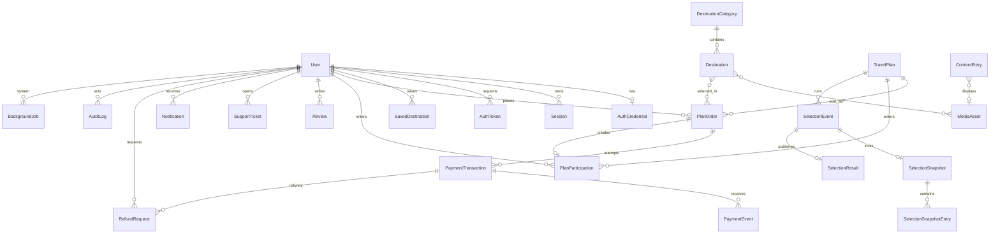

# Data Model — Lucky Travel Ethiopia

| Field | Value |
| --- | --- |
| Status | Draft for Phase 1 review; implemented in Phase 3 onward |
| Database | MongoDB 7+ replica set (transactions required), Mongoose 9.x |
| Currency | ETB, stored as integer minor units (`santim`) |
| Timestamps | UTC in the database; displayed in `Africa/Addis_Ababa` |
| Localized content | `{ en: string, am: string }`; both required to publish |
| Collection naming | plural `snake_case`; fields `camelCase` |

This is a design contract, not a claim that the collections exist. No production destination data, prices, selection rules or legal copy is defined here.

## 1. Conventions

### 1.1 Identifiers

- Internal references use MongoDB `ObjectId`.
- Public-facing records additionally have an opaque `publicId` (for example `ord_...`, `evt_...`, `res_...`) generated with a cryptographically secure random source. Public URLs do not expose sequential values.
- `slug` is a stable, language-neutral URL identifier. It is not translated. Changing a published slug creates a permanent redirect.
- Human-readable order/refund/event references are unique and non-sequential (e.g. `LTE-ORD-...`, `LTE-EVT-...`, `LTE-RES-...`).

### 1.2 Localized text

```ts
type LocalizedText = {
  en: string;
  am: string;
};
```

Rules:

- Stored as an embedded document with `_id: false`.
- Both values are trimmed and length-limited by schema and service validation.
- Draft saves may omit Amharic, but **any publish/activation transition requires both** `en` and `am` for every required localized field. This is enforced in the service layer because Mongoose child schemas cannot see the parent's status.
- Public pages never silently show untranslated placeholder text. Published content is complete; an administrator sees a translation-completeness warning in the CMS.
- Legal/policy pages additionally record human legal/translation review metadata. They are not machine-translated into Amharic.
- Rich text is stored as sanitized Markdown or a restricted HTML subset. Destinations, plan terms, FAQs and policies all use the same allowlist.

### 1.3 Money

- Every amount field ends in `Minor` and is a non-negative integer.
- ETB is the only v1 currency; `currency` is still stored on financial records for future-proofing.
- Percentage rates use basis points (`taxRateBps`, e.g. 1500 = 15%).
- Rounding uses a documented `roundingPolicy` (`half_up_to_minor`) and a pricing-engine version.
- Financial records never store floating-point money.

### 1.4 Soft deletion and immutability

- Content (`Destination`, `DestinationCategory`, `TravelPlan`, `MediaAsset`, `ContentEntry`) uses `deletedAt`/`deletedBy` and status `archived` where appropriate. Hard delete is restricted and audited.
- Orders, payments, payment events, participations, selection snapshots, results, notifications and audit logs are **not hard-deleted by normal admin UI**.
- Financial and selection records are corrected with new records/versions and audit entries, never by silently editing history.

### 1.5 Idempotency and concurrency

- Write-heavy/retryable workflows carry an `idempotencyKey` with a unique sparse index.
- State transitions use conditional updates with expected `status` and `version` (`findOneAndUpdate`), or transactions with unique constraints.
- Mongoose optimistic concurrency is enabled on workflow documents.
- Every external retry receives the same idempotency key; a fresh user intent gets a new key.

### 1.6 Common fields

Unless stated otherwise:

```ts
type CommonFields = {
  _id: ObjectId;
  createdAt: Date;
  updatedAt: Date;
  createdBy?: ObjectId;   // administrator or system actor
  updatedBy?: ObjectId;
};
```

No password hash, session token, provider secret, raw identity document or payment credential is embedded in public-facing documents.

## 2. Collection overview

| # | Collection | Purpose |
| --- | --- | --- |
| 1 | `users` | Domain account/profile and role |
| 2 | `auth_credentials` | Argon2id hash and MFA material (separated from profile) |
| 3 | `sessions` | Revocable server-side sessions |
| 4 | `auth_tokens` | Email verification, password reset, email change tokens |
| 5 | `saved_destinations` | Per-user saved destination references |
| 6 | `destination_categories` | Configurable categories |
| 7 | `destinations` | Bilingual destination content and pricing |
| 8 | `media_assets` | Object-storage metadata and localized alt/caption |
| 9 | `travel_plans` | Standard/custom plan configuration |
| 10 | `plan_orders` | Immutable pricing/rules snapshots and order state |
| 11 | `payment_transactions` | Payment attempts and verified state |
| 12 | `payment_events` | Raw/sanitized provider callback ledger |
| 13 | `plan_participations` | Eligible entries into a plan/selection event |
| 14 | `refund_requests` | Refund workflow and provider outcome |
| 15 | `selection_events` | Event rules, approvals and state machine |
| 16 | `selection_snapshots` | Locked snapshot manifest |
| 17 | `selection_snapshot_entries` | Scalable per-participant snapshot rows |
| 18 | `selection_results` | Immutable published outcome |
| 19 | `notifications` | In-app notifications and delivery dedupe |
| 20 | `reviews` | Moderated destination reviews |
| 21 | `support_tickets` | User support conversations |
| 22 | `audit_logs` | Append-only administrative/security audit |
| 23 | `platform_settings` | Feature flags, legal gates, non-secret settings |
| 24 | `background_jobs` | Durable business job ledger + BullMQ linkage |
| 25 | `content_entries` | Homepage, FAQs, policies, banners, verified testimonials |

`DestinationCategory` is the conceptual name used in requirements; the collection is `destination_categories`, the Mongoose model is `DestinationCategory`.

## 3. Identity and access

### 3.1 `users`

```ts
type User = {
  _id: ObjectId;
  publicId: string;                    // unique, opaque
  email: string;                       // lowercased, trimmed, unique
  emailVerifiedAt: Date | null;
  name: string;                        // 2..120 chars
  phone: string | null;                // E.164 normalized when present
  phoneVerifiedAt: Date | null;
  role: "user" | "admin" | "super_admin";
  status: "active" | "suspended" | "deactivated" | "pending_deletion";
  preferredLocale: "en" | "am";
  avatarMediaId: ObjectId | null;
  notificationPreferences: {
    inApp: boolean;
    email: boolean;
    sms: boolean;
    productUpdates: boolean;
  };
  termsAcceptedAt: Date | null;
  termsVersion: string | null;
  privacyAcceptedAt: Date | null;
  lastLoginAt: Date | null;
  deactivatedAt: Date | null;
  deletedAt: Date | null;
  createdAt: Date;
  updatedAt: Date;
};
```

Visitors are unauthenticated and have no database role. `admin`/`super_admin` accounts have a mandatory MFA enrolment gate.

Indexes:

```text
{ email: 1 }                                   unique
{ publicId: 1 }                                unique
{ phone: 1 }                                   unique, partial: { phone: { $type: "string" } }
{ role: 1, status: 1, createdAt: -1 }
{ status: 1, createdAt: -1 }
{ createdAt: -1 }
```

### 3.2 `auth_credentials`

One document per user, separated so profile queries cannot accidentally return secrets.

```ts
type AuthCredential = {
  _id: ObjectId;
  userId: ObjectId;                    // unique
  passwordHash: string;                // select: false
  passwordAlgorithm: "argon2id";
  passwordParams: { memoryKiB: number; iterations: number; parallelism: number; version: number };
  passwordUpdatedAt: Date;
  mfa: {
    enabled: boolean;
    secretCiphertext: string | null;   // AES-256-GCM, select: false
    secretIv: string | null;
    secretTag: string | null;
    recoveryCodeHashes: string[];      // one-way hashed, select: false
    enabledAt: Date | null;
    lastUsedAt: Date | null;
  };
  mustChangePassword: boolean;
  createdAt: Date;
  updatedAt: Date;
};
```

Index: `{ userId: 1 }` unique.

### 3.3 `sessions`

```ts
type Session = {
  _id: ObjectId;
  userId: ObjectId;
  tokenHash: string;                   // HMAC-SHA-256 of opaque token; unique
  lastSeenAt: Date;
  expiresAt: Date;                     // idle expiry
  absoluteExpiresAt: Date;             // hard maximum
  rotatedFrom: ObjectId | null;
  mfaVerifiedAt: Date | null;
  ipHmac: string | null;               // privacy-preserving HMAC, not raw IP
  userAgent: string | null;            // truncated, redacted
  revokedAt: Date | null;
  revokedReason: "logout" | "password_change" | "email_change" | "admin_revoke" | "suspicious" | null;
  createdAt: Date;
  updatedAt: Date;
};
```

Indexes:

```text
{ tokenHash: 1 } unique
{ userId: 1, revokedAt: 1, lastSeenAt: -1 }
{ expiresAt: 1 } TTL expireAfterSeconds: 0
```

Sessions are invalidated on logout, password/email change, administrative suspension and security incidents. Do not cache a revocation longer than the configured security window.

### 3.4 `auth_tokens`

```ts
type AuthToken = {
  _id: ObjectId;
  userId: ObjectId;
  type: "email_verification" | "password_reset" | "email_change" | "admin_invite";
  tokenHash: string;                   // HMAC-SHA-256
  expiresAt: Date;
  usedAt: Date | null;
  revokedAt: Date | null;
  metadata: { newEmail?: string };
  requestedIpHmac: string | null;
  createdAt: Date;
};
```

Indexes: `{ tokenHash: 1 }` unique; `{ userId: 1, type: 1, expiresAt: -1 }`; TTL on `expiresAt`. Only one active token per type is issued at a time (previous tokens revoked).

### 3.5 `saved_destinations`

```ts
type SavedDestination = {
  _id: ObjectId;
  userId: ObjectId;
  destinationId: ObjectId;
  createdAt: Date;
};
```

Indexes: `{ userId: 1, destinationId: 1 }` unique; `{ userId: 1, createdAt: -1 }`. Hard delete when the user unsaves.

## 4. Catalogue and media

### 4.1 `destination_categories`

```ts
type DestinationCategory = {
  _id: ObjectId;
  publicId: string;
  slug: string;                        // unique, language-neutral
  name: LocalizedText;
  description: LocalizedText;
  imageMediaId: ObjectId | null;
  imageAlt: LocalizedText;
  displayOrder: number;                // integer >= 0
  status: "draft" | "published" | "archived";
  seo: {
    title: LocalizedText;
    description: LocalizedText;
  };
  createdAt: Date;
  updatedAt: Date;
  publishedAt: Date | null;
  archivedAt: Date | null;
  createdBy: ObjectId;
  updatedBy: ObjectId;
  deletedAt: Date | null;
  version: number;
};
```

Indexes: `{ slug: 1 }` unique; `{ status: 1, displayOrder: 1 }`; `{ status: 1, updatedAt: -1 }`.

Deletion is blocked while destinations reference the category. Reassign first or archive.

### 4.2 `destinations`

```ts
type Destination = {
  _id: ObjectId;
  publicId: string;
  slug: string;
  name: LocalizedText;
  primaryCategoryId: ObjectId;
  categoryIds: ObjectId[];             // includes primary; max 10
  shortDescription: LocalizedText;     // max ~200 chars
  fullDescription: LocalizedText;      // sanitized Markdown/HTML subset
  mainImage: {
    mediaId: ObjectId;
    alt: LocalizedText;
  } | null;
  gallery: Array<{
    mediaId: ObjectId;
    alt: LocalizedText;
    caption: LocalizedText;
    order: number;
  }>;
  region: LocalizedText;
  city: LocalizedText;
  coordinates: { type: "Point"; coordinates: [number, number] } | null; // [lng, lat]
  mapUrl: string | null;               // validated https URL; never fetched server-side
  entryPriceMinor: number;             // >= 0
  transportationPriceMinor: number | null;
  accommodationPriceMinor: number | null;
  currency: "ETB";
  priceNote: LocalizedText;            // explains what the price includes / excludes
  visitDurationMinutes: number | null;
  openingHours: LocalizedText;
  bestTimeToVisit: LocalizedText;
  accessibility: LocalizedText;
  contact: {
    phone: string | null;
    email: string | null;
    website: string | null;
  };
  travelTips: LocalizedText;
  status: "draft" | "published" | "archived";
  featured: boolean;
  priceVerifiedAt: Date | null;        // admin confirms price is current
  priceVerifiedBy: ObjectId | null;
  contentVerifiedAt: Date | null;      // admin confirms factual content
  seo: {
    title: LocalizedText;
    description: LocalizedText;
  };
  searchText: {
    en: string;                        // normalized searchable text
    am: string;
  };
  publishedAt: Date | null;
  archivedAt: Date | null;
  createdBy: ObjectId;
  updatedBy: ObjectId;
  deletedAt: Date | null;
  version: number;
  createdAt: Date;
  updatedAt: Date;
};
```

Indexes:

```text
{ slug: 1 } unique
{ status: 1, featured: 1, publishedAt: -1 }
{ status: 1, categoryIds: 1, publishedAt: -1 }
{ status: 1, region.en: 1, publishedAt: -1 }
{ status: 1, entryPriceMinor: 1, publishedAt: -1 }
{ searchText: "text" }                    // fallback; Atlas Search preferred
{ coordinates: "2dsphere" }               // partial: coordinates exists
```

`searchText` is derived by a service from bilingual names/descriptions/regions. It is not directly editable in the CMS. Amharic search is tested; do not assume Mongo's language analyzers support Amharic adequately.

Publication requires name, descriptions, categories, region/city, main image alt text, price note, and SEO fields in both languages, plus verified price/content timestamps.

### 4.3 `media_assets`

```ts
type MediaAsset = {
  _id: ObjectId;
  publicId: string;
  storageKey: string;                  // random, server-generated
  bucket: string;
  provider: "s3" | "r2" | "minio";
  mimeType: "image/jpeg" | "image/png" | "image/webp";
  sizeBytes: number;
  width: number;
  height: number;
  checksumSha256: string;
  alt: LocalizedText;
  caption: LocalizedText;
  status: "pending" | "ready" | "rejected" | "deleted";
  ownerId: ObjectId;                   // uploader/admin
  createdBy: ObjectId;
  createdAt: Date;
  updatedAt: Date;
  deletedAt: Date | null;
};
```

Indexes: `{ publicId: 1 }` unique; `{ storageKey: 1 }` unique; `{ checksumSha256: 1 }`; `{ ownerId: 1, createdAt: -1 }`; `{ status: 1, createdAt: -1 }`.

No binary data is stored in MongoDB. A `pending` asset cannot be published. Re-encoding must complete before `ready`.

## 5. Plans, orders and participation

### 5.1 `travel_plans`

```ts
type TravelPlan = {
  _id: ObjectId;
  publicId: string;
  slug: string;
  name: LocalizedText;
  summary: LocalizedText;
  description: LocalizedText;
  planType: "standard" | "custom";
  status: "draft" | "active" | "closed" | "archived";
  featured: boolean;
  customPlanEnabled: boolean;          // for custom plan creation
  allowedDestinationCounts: number[];  // admin-configured, defaults [10, 20]
  fixedDestinationIds: ObjectId[];     // standard plans; empty for custom
  pricingConfig: {
    currency: "ETB";
    base: "sum_of_destinations" | "fixed_amount";
    fixedAmountMinor: number | null;
    participationFeeMinor: number;
    serviceFeeMinor: number;
    taxRateBps: number;                // 0..10000
    taxLabel: LocalizedText;
    discountRules: Array<{
      code: string;
      type: "fixed" | "percent";
      valueMinor?: number;
      valueBps?: number;
      validFrom: Date | null;
      validUntil: Date | null;
      maxUses: number | null;
      active: boolean;
    }>;
    roundingPolicy: "half_up_to_minor";
  };
  inclusions: LocalizedText;           // what the price actually covers
  exclusions: LocalizedText;
  eligibility: {
    minAge: number | null;
    residency: "any" | "ethiopia" | "diaspora";
    verifiedEmailRequired: boolean;
    verifiedPhoneRequired: boolean;
    verifiedPaymentRequired: boolean;
    oneEntryPerUser: boolean;
  };
  eligibilityText: LocalizedText;
  rules: LocalizedText;
  refundPolicy: LocalizedText;
  cancellationPolicy: LocalizedText;
  termsVersion: string;
  rulesHash: string;                   // hash of published rules/eligibility content
  legalReview: {
    reference: string | null;
    approvedAt: Date | null;
    approvedByUserId: ObjectId | null;
  } | null;
  startsAt: Date | null;
  endsAt: Date | null;
  participantLimit: number | null;
  publishedAt: Date | null;
  createdBy: ObjectId;
  updatedBy: ObjectId;
  deletedAt: Date | null;
  version: number;
  createdAt: Date;
  updatedAt: Date;
};
```

Indexes: `{ slug: 1 }` unique; `{ publicId: 1 }` unique; `{ status: 1, startsAt: 1 }`; `{ status: 1, featured: 1 }`; `{ planType: 1, status: 1 }`.

Activation requires localized name/summary/description/inclusions/eligibility/rules/refund/cancellation, a valid pricing configuration, dates/limits where applicable and all required business approvals. A paid plan cannot be activated with empty price-composition text.

### 5.2 `plan_orders`

```ts
type PlanOrder = {
  _id: ObjectId;
  publicId: string;
  orderNumber: string;                 // unique, human-readable
  userId: ObjectId;
  planId: ObjectId;
  orderType: "standard" | "custom";
  status:
    | "pending_payment"
    | "paid"
    | "payment_failed"
    | "expired"
    | "cancelled"
    | "refund_pending"
    | "refunded";
  currency: "ETB";
  destinationCount: number;
  selectedDestinations: Array<{
    destinationId: ObjectId;
    slug: string;
    name: LocalizedText;
    imageMediaId: ObjectId | null;
    categoryIds: ObjectId[];
    entryPriceMinor: number;           // price at order time
  }>;
  pricingSnapshot: {
    engineVersion: string;
    currency: "ETB";
    lines: Array<{
      code: "destination" | "participation_fee" | "service_fee" | "tax" | "discount";
      label: LocalizedText;
      amountMinor: number;             // discounts stored as positive and subtracted
    }>;
    destinationSubtotalMinor: number;
    feesMinor: number;
    taxMinor: number;
    discountMinor: number;
    totalMinor: number;
    roundingPolicy: "half_up_to_minor";
    calculatedAt: Date;
  };
  planRulesSnapshot: {
    rules: LocalizedText;
    eligibility: TravelPlan["eligibility"];
    eligibilityText: LocalizedText;
    refundPolicy: LocalizedText;
    cancellationPolicy: LocalizedText;
    inclusions: LocalizedText;
    termsVersion: string;
    rulesHash: string;
  };
  termsAcceptedAt: Date;
  termsVersion: string;
  idempotencyKey: string;              // unique
  activeOrderKey: string | null;       // e.g. userId:planId while pending; unset on final state
  expiresAt: Date;
  paidAt: Date | null;
  cancelledAt: Date | null;
  cancellationReason: string | null;
  createdAt: Date;
  updatedAt: Date;
  version: number;
};
```

Indexes:

```text
{ orderNumber: 1 } unique
{ publicId: 1 } unique
{ idempotencyKey: 1 } unique
{ activeOrderKey: 1 } unique, sparse: true
{ userId: 1, createdAt: -1 }
{ planId: 1, status: 1, createdAt: -1 }
{ status: 1, expiresAt: 1 }
```

`activeOrderKey` is unset when the order becomes paid/expired/cancelled/refunded so a user can start a new order after a failed attempt, while duplicate active orders are prevented. This default is configurable and requires business confirmation for multi-entry plans.

Once created, the pricing snapshot and selected destination snapshot are immutable. Price changes only affect new orders.

### 5.3 `payment_transactions`

```ts
type PaymentTransaction = {
  _id: ObjectId;
  publicId: string;
  orderId: ObjectId;
  userId: ObjectId;
  provider: "telebirr" | "mock";
  merchantOrderId: string;             // provider-facing, unique per attempt
  providerTransactionId: string | null;
  amountMinor: number;
  currency: "ETB";
  status:
    | "initiated"
    | "pending"
    | "succeeded"
    | "failed"
    | "cancelled"
    | "uncertain"
    | "refunded"
    | "partially_refunded"
    | "reversed";
  verificationStatus: "unverified" | "verified" | "mismatch" | "not_found";
  reconciliationStatus: "not_required" | "pending" | "in_progress" | "matched" | "discrepancy" | "resolved";
  providerReferenceSafe: string | null;
  providerStatusSafe: string | null;    // allowlisted/normalized, never a secret
  requestHash: string;
  responseHash: string;
  idempotencyKey: string;              // unique
  initiatedAt: Date;
  verifiedAt: Date | null;
  completedAt: Date | null;
  lastCheckedAt: Date | null;
  failureCode: string | null;
  failureMessageSafe: string | null;
  refundedAmountMinor: number;         // default 0
  metadata: {
    initiationChannel: "web" | "mobile" | "admin";
    providerMode: "sandbox" | "live" | "mock";
  };
  createdAt: Date;
  updatedAt: Date;
  version: number;
};
```

Indexes:

```text
{ idempotencyKey: 1 } unique
{ publicId: 1 } unique
{ provider: 1, merchantOrderId: 1 } unique
{ provider: 1, providerTransactionId: 1 } unique, partial: { providerTransactionId: { $type: "string" } }
{ orderId: 1, status: 1 }
{ userId: 1, createdAt: -1 }
{ status: 1, reconciliationStatus: 1, createdAt: 1 }
```

No raw card/mobile-money credentials, PINs, OTPs or merchant secrets are stored. Provider payloads are stored only as redacted/hashed evidence; the verified state and safe references are authoritative.

### 5.4 `payment_events`

```ts
type PaymentEvent = {
  _id: ObjectId;
  provider: "telebirr" | "mock";
  providerEventId: string;             // unique per provider; replay protection
  paymentId: ObjectId;
  orderId: ObjectId;
  eventType: string;                   // allowlisted provider event type
  signatureVerified: boolean;
  payloadHash: string;
  sanitizedPayload: Record<string, unknown>; // no secrets/PII beyond safe fields
  receivedAt: Date;
  processedAt: Date | null;
  processingOutcome: "accepted" | "duplicate" | "rejected" | "failed" | "pending_reconciliation";
  createdAt: Date;
};
```

Indexes: `{ provider: 1, providerEventId: 1 }` unique; `{ paymentId: 1, createdAt: 1 }`; `{ processingOutcome: 1, receivedAt: 1 }`.

### 5.5 `plan_participations`

```ts
type PlanParticipation = {
  _id: ObjectId;
  publicId: string;
  orderId: ObjectId;                   // unique
  paymentId: ObjectId;
  userId: ObjectId;
  planId: ObjectId;
  selectionEventId: ObjectId | null;
  status:
    | "eligible"
    | "ineligible"
    | "disqualified"
    | "cancelled"
    | "winner"
    | "not_selected"
    | "refunded";
  eligibility: {
    emailVerified: boolean;
    phoneVerified: boolean;
    paymentVerified: boolean;
    ageSatisfied: boolean | null;
    residencySatisfied: boolean | null;
    notPreviouslyEntered: boolean;
    rulesVersion: string;
    evaluatedAt: Date;
  };
  eligibleAt: Date;
  disqualifiedReason: string | null;
  snapshotId: ObjectId | null;
  createdAt: Date;
  updatedAt: Date;
  version: number;
};
```

Indexes:

```text
{ orderId: 1 } unique
{ publicId: 1 } unique
{ userId: 1, createdAt: -1 }
{ planId: 1, status: 1, eligibleAt: -1 }
{ selectionEventId: 1, userId: 1 } unique, partial: { selectionEventId: { $type: "objectId" } }
{ snapshotId: 1 }
```

A participation is created only after a verified payment and a server-side eligibility evaluation. It is not created because a browser says payment succeeded. One entry per user per event is the default; changing it is a versioned business rule.

### 5.6 `refund_requests`

```ts
type RefundRequest = {
  _id: ObjectId;
  publicId: string;
  refundNumber: string;                // unique
  orderId: ObjectId;
  paymentId: ObjectId;
  userId: ObjectId;
  amountMinor: number;                 // <= captured amount
  currency: "ETB";
  reasonCategory: "cancelled_by_user" | "event_cancelled" | "duplicate" | "provider_error" | "other";
  reasonText: string;                  // user-provided, sanitized
  status: "requested" | "under_review" | "approved" | "rejected" | "processing" | "succeeded" | "failed";
  reviewedBy: ObjectId | null;
  reviewedAt: Date | null;
  decisionReason: string | null;
  providerRefundId: string | null;
  processedAt: Date | null;
  failureReasonSafe: string | null;
  internalNotes: string | null;        // admin-only, audit-logged
  createdAt: Date;
  updatedAt: Date;
  version: number;
};
```

Indexes: `{ refundNumber: 1 }` unique; `{ publicId: 1 }` unique; `{ orderId: 1, status: 1 }`; `{ status: 1, createdAt: 1 }`; `{ userId: 1, createdAt: -1 }`.

Refund status changes are transactional/idempotent and audited. The provider may not support an API; the platform records a manual provider outcome rather than claiming an automated refund.

## 6. Selection engine

### 6.1 `selection_events`

```ts
type SelectionEvent = {
  _id: ObjectId;
  publicId: string;
  eventCode: string;                    // unique
  planId: ObjectId;
  name: LocalizedText;
  description: LocalizedText;
  publicRules: LocalizedText;
  prizeOrTripTerms: LocalizedText;
  refundPolicy: LocalizedText;
  cancellationPolicy: LocalizedText;
  status:
    | "draft"
    | "open"
    | "closed"
    | "snapshot_locked"
    | "selection_pending"
    | "selecting"
    | "results_published"
    | "cancelled"
    | "failed"
    | "postponed";
  timezone: "Africa/Addis_Ababa";
  openAt: Date;
  closeAt: Date;
  scheduledSelectionAt: Date;
  participantPolicy: {
    interpretation: "eligible_participant_count" | "start_threshold" | "winner_count" | null;
    target: number | null;             // proposed 20
    sequence: number[];                // proposed 20,21,19,22,...
    minimum: number | null;
    maximum: number | null;
    winners: number | null;
    extensionPolicy: "extend" | "postpone" | "cancel_and_refund" | null;
    gracePeriodHours: number | null;
  };
  method: "crypto_random_shuffle_v1" | "crypto_random_sample_v1" | null;
  methodVersion: string | null;
  rulesVersion: string;
  rulesHash: string;
  snapshot: {
    snapshotId: ObjectId | null;
    participantCount: number | null;
    manifestHash: string | null;
    lockedAt: Date | null;
    lockedBy: ObjectId | null;
  };
  approvals: Array<{
    action: "open" | "lock_snapshot" | "start_selection" | "publish_result";
    adminId: ObjectId;
    approvedAt: Date;
    note: string | null;
    mfaVerifiedAt: Date;
  }>;
  legalApproval: {
    reference: string | null;
    approvedAt: Date | null;
    approvedBy: string | null;
  };
  seedCommitment: string | null;        // SHA-256 of secret seed, published before selection
  seedReveal: string | null;            // revealed only after result publication
  resultId: ObjectId | null;
  publicDisplayEnabled: boolean;
  createdBy: ObjectId;
  updatedBy: ObjectId;
  version: number;
  createdAt: Date;
  updatedAt: Date;
};
```

Indexes: `{ eventCode: 1 }` unique; `{ publicId: 1 }` unique; `{ planId: 1, status: 1 }`; `{ status: 1, openAt: 1 }`; `{ status: 1, closeAt: 1 }`; `{ scheduledSelectionAt: 1, status: 1 }`.

`participantPolicy.interpretation` must be explicitly approved before `open`. The sequence is configuration, not an algorithm; it never determines winners.

State transition rules:

```text
DRAFT -> OPEN
OPEN -> CLOSED | CANCELLED
CLOSED -> SNAPSHOT_LOCKED | CANCELLED | POSTPONED
SNAPSHOT_LOCKED -> SELECTION_PENDING | FAILED
SELECTION_PENDING -> SELECTING | CANCELLED
SELECTING -> RESULTS_PUBLISHED | FAILED
POSTPONED -> OPEN | CANCELLED
```

No backwards edit of rules after `OPEN`. A material rule change creates a new event. Results publication is terminal and immutable; corrections use an audited new correction record/event, never an in-place result edit.

### 6.2 `selection_snapshots`

```ts
type SelectionSnapshot = {
  _id: ObjectId;
  publicId: string;
  eventId: ObjectId;                    // unique
  rulesVersion: string;
  rulesHash: string;
  participantCount: number;
  manifestHash: string;                 // canonical manifest hash
  hashAlgorithm: "sha256";
  canonicalizationVersion: string;
  storageStrategy: "entries_collection";
  builtAt: Date;
  builtByJobId: ObjectId;
  lockedAt: Date;
  lockedBy: ObjectId;
  createdAt: Date;
};
```

Indexes: `{ eventId: 1 }` unique; `{ publicId: 1 }` unique; `{ manifestHash: 1 }`.

### 6.3 `selection_snapshot_entries`

Scalable per-participant representation; avoids a single document exceeding MongoDB's limits.

```ts
type SelectionSnapshotEntry = {
  _id: ObjectId;
  snapshotId: ObjectId;
  eventId: ObjectId;
  participationId: ObjectId;
  userId: ObjectId;
  canonicalIndex: number;              // deterministic order
  entryHash: string;                   // hash of canonical entry evidence
  eligible: boolean;
  createdAt: Date;
};
```

Indexes: `{ snapshotId: 1, participationId: 1 }` unique; `{ snapshotId: 1, canonicalIndex: 1 }` unique; `{ eventId: 1, userId: 1 }`; `{ snapshotId: 1, entryHash: 1 }`.

Entries are written before lock and are immutable after `snapshot_locked`. Participant identities are never exposed publicly without lawful consent; public verification uses hashes/masked labels.

### 6.4 `selection_results`

```ts
type SelectionResult = {
  _id: ObjectId;
  publicId: string;
  verificationRef: string;             // unique, public verification reference
  eventId: ObjectId;                   // unique
  method: "crypto_random_shuffle_v1" | "crypto_random_sample_v1";
  methodVersion: string;
  snapshotHash: string;
  rulesHash: string;
  participantCount: number;
  winnerCount: number;
  winners: Array<{
    entryId: ObjectId;
    participationId: ObjectId;
    userId: ObjectId;                  // private, server only
    maskedDisplayName: string;         // privacy-safe default
    rank: number;
  }>;
  seedCommitment: string;
  seedReveal: string | null;           // populated at publication
  selectionEvidence: {
    algorithmVersion: string;
    sampleMethod: "rejection_sampling";
    drawnAt: Date;
    verificationInstructionsUrl: string;
  };
  resultHash: string;
  selectedAt: Date;
  publishedAt: Date | null;
  publishedBy: ObjectId | null;
  publishedApprovalId: ObjectId | null;
  isVoided: boolean;                   // optional audited correction marker; avoid normal use
  voidedAt: Date | null;
  voidReason: string | null;
  createdAt: Date;
  updatedAt: Date;
};
```

Indexes: `{ eventId: 1 }` unique; `{ verificationRef: 1 }` unique; `{ publicId: 1 }` unique; `{ publishedAt: -1 }`.

The authoritative result is persisted before any display animation. Public DTOs omit `userId`, participation IDs and private contact data unless specifically lawful/consented.

## 7. Engagement and operations

### 7.1 `notifications`

```ts
type Notification = {
  _id: ObjectId;
  publicId: string;
  userId: ObjectId;
  type:
    | "email_verified"
    | "payment_status"
    | "order_status"
    | "selection_event"
    | "result_published"
    | "refund_update"
    | "security_alert"
    | "support_reply";
  title: LocalizedText;
  body: LocalizedText;
  data: Record<string, string>;        // safe IDs/links only
  dedupeKey: string;                   // unique; repeated delivery is idempotent
  channel: "in_app" | "email" | "sms";
  readAt: Date | null;
  expiresAt: Date | null;
  createdAt: Date;
  updatedAt: Date;
};
```

Indexes: `{ userId: 1, createdAt: -1 }`; `{ userId: 1, readAt: 1, createdAt: -1 }`; `{ dedupeKey: 1 }` unique; TTL on `expiresAt` (only when policy allows; expiry unset for important financial records).

### 7.2 `reviews`

```ts
type Review = {
  _id: ObjectId;
  publicId: string;
  userId: ObjectId;
  destinationId: ObjectId;
  rating: 1 | 2 | 3 | 4 | 5;
  title: string;
  body: string;
  status: "pending" | "published" | "rejected" | "hidden";
  moderatedBy: ObjectId | null;
  moderatedAt: Date | null;
  moderationReason: string | null;
  verifiedVisitAt: Date | null;        // only if a legitimate source exists
  createdAt: Date;
  updatedAt: Date;
};
```

Indexes: `{ userId: 1, destinationId: 1 }` unique; `{ destinationId: 1, status: 1, createdAt: -1 }`; `{ status: 1, createdAt: 1 }`.

Reviews are user-generated and not translated by the platform. No fake "verified" claims.

### 7.3 `support_tickets`

```ts
type SupportTicket = {
  _id: ObjectId;
  publicId: string;
  ticketNumber: string;                // unique
  userId: ObjectId;
  subject: string;
  category: "account" | "payment" | "plan" | "selection" | "technical" | "other";
  priority: "low" | "normal" | "high" | "urgent";
  status: "open" | "pending_user" | "pending_admin" | "resolved" | "closed";
  messages: Array<{
    messageId: ObjectId;
    authorId: ObjectId;
    authorRole: "user" | "admin" | "system";
    body: string;                       // sanitized plain text/restricted Markdown
    internal: boolean;
    createdAt: Date;
  }>;
  assignedTo: ObjectId | null;
  lastMessageAt: Date;
  createdAt: Date;
  updatedAt: Date;
};
```

Indexes: `{ ticketNumber: 1 }` unique; `{ publicId: 1 }` unique; `{ userId: 1, createdAt: -1 }`; `{ status: 1, priority: 1, updatedAt: -1 }`.

### 7.4 `audit_logs`

```ts
type AuditLog = {
  _id: ObjectId;
  actorId: ObjectId | null;            // null for system jobs
  actorRole: "user" | "admin" | "super_admin" | "system" | null;
  action: string;                      // allowlisted, versioned action key
  entityType: string;
  entityId: string;
  outcome: "success" | "denied" | "failed";
  reason: string | null;
  requestId: string | null;
  ipHmac: string | null;
  userAgent: string | null;
  beforeHash: string | null;
  afterHash: string | null;
  diff: Record<string, unknown> | null; // redacted, allowlisted fields only
  createdAt: Date;
};
```

Indexes: `{ createdAt: -1 }`; `{ actorId: 1, createdAt: -1 }`; `{ entityType: 1, entityId: 1, createdAt: -1 }`; `{ action: 1, createdAt: -1 }`.

Append-only. No application role can update/delete logs; production database permissions enforce this. Sensitive action logs are retained per policy (minimum 2 years; financial/selection retention subject to legal review).

### 7.5 `platform_settings`

```ts
type PlatformSetting = {
  _id: ObjectId;
  key: string;                          // unique, allowlisted
  category: "feature_flag" | "legal" | "contact" | "content" | "operations";
  value: unknown;                       // validated by a per-key Zod schema
  description: string;
  isPublic: boolean;                    // only public-safe keys may be exposed
  updatedBy: ObjectId | null;
  version: number;
  createdAt: Date;
  updatedAt: Date;
};
```

Indexes: `{ key: 1 }` unique; `{ category: 1 }`; `{ isPublic: 1 }`.

Feature flags include `customPlansEnabled`, `prizeSelectionsEnabled`, `publicSelectionDisplayEnabled`, `amharicEnabled`, `rewardSelectionsLegalApproval` metadata and maintenance modes. Secrets are **not** stored here.

### 7.6 `background_jobs`

```ts
type BackgroundJob = {
  _id: ObjectId;
  jobId: string;                        // unique, maps to BullMQ job
  type:
    | "payment_reconcile"
    | "payment_callback_process"
    | "notification_deliver"
    | "refund_reconcile"
    | "selection_build_snapshot"
    | "selection_execute"
    | "media_process"
    | "cleanup_expired";
  status: "queued" | "running" | "succeeded" | "failed" | "dead_letter";
  idempotencyKey: string;               // unique
  payload: Record<string, unknown>;     // safe references only, no secrets
  attempts: number;
  maxAttempts: number;
  runAt: Date;
  lockedAt: Date | null;
  lockedBy: string | null;
  lockExpiresAt: Date | null;
  lastErrorSafe: string | null;
  resultSummary: Record<string, unknown> | null;
  createdAt: Date;
  updatedAt: Date;
};
```

Indexes: `{ jobId: 1 }` unique; `{ idempotencyKey: 1 }` unique; `{ type: 1, status: 1, runAt: 1 }`; `{ status: 1, lockedUntil: 1 }`.

BullMQ is the dispatch/retry mechanism; this collection is the human-auditable business ledger and supports recovery if Redis data is lost.

### 7.7 `content_entries`

Used for homepage sections, FAQs, banners, policy pages, about/contact prose and authentic testimonials.

```ts
type ContentEntry = {
  _id: ObjectId;
  publicId: string;
  key: string;                          // unique, e.g. "home.hero", "faq.refund"
  type: "homepage_section" | "faq" | "policy" | "banner" | "testimonial" | "page";
  title: LocalizedText;
  subtitle: LocalizedText;
  body: LocalizedText;                  // sanitized
  ctaLabel: LocalizedText;
  ctaHref: string | null;
  mediaId: ObjectId | null;
  imageAlt: LocalizedText;
  displayOrder: number;
  status: "draft" | "published" | "archived";
  seo: { title: LocalizedText; description: LocalizedText };
  legalReview: {
    required: boolean;
    reviewedAt: Date | null;
    reviewedBy: string | null;
    reference: string | null;
  };
  verifiedSource: string | null;        // required for testimonials
  publishedAt: Date | null;
  createdBy: ObjectId;
  updatedBy: ObjectId;
  version: number;
  createdAt: Date;
  updatedAt: Date;
};
```

Indexes: `{ key: 1 }` unique; `{ type: 1, status: 1, displayOrder: 1 }`; `{ status: 1, publishedAt: -1 }`.

## 8. Relationships



- `TravelPlan` may be standard (fixed destination list) or custom (user selects an allowed count).
- An order belongs to exactly one plan and one user.
- A participation belongs to exactly one verified order; one user can have multiple orders over time, but the default rule is one active entry per plan/event.
- A selection event belongs to one plan. Snapshot entries reference one participation each.
- A result belongs to exactly one event and is immutable.

## 9. Transaction boundaries and invariants

### 9.1 Payment success

In one MongoDB transaction (replica set required):

1. Lock/read the order with expected `pending_payment` state.
2. Verify the payment amount/currency/merchant order/status.
3. Insert/update exactly one successful `PaymentTransaction` (unique idempotency/provider reference).
4. Update the order to `paid` and set `paidAt`.
5. Create at most one `PlanParticipation` for the order (unique `orderId`).
6. Create an outbox/`BackgroundJob` record for notifications.
7. Write the audit log.

If the provider is uncertain, the order stays pending and a reconciliation job retries; it is never optimistically marked paid.

### 9.2 Duplicate callback

The unique `(provider, providerEventId)` index and idempotency key make duplicate callbacks safe. Duplicate callbacks return a success acknowledgement but do not duplicate transactions/participations.

### 9.3 Snapshot lock

In one transaction:

1. Verify event is `closed`.
2. Confirm reconciliation has no unresolved payments for the eligible scope.
3. Verify eligible count/rules and dual approval.
4. Insert snapshot + all entries (or mark existing staged entries immutable).
5. Compute/verify canonical manifest hash.
6. Update event to `snapshot_locked` with snapshot metadata.
7. Write audit log.

After commit, events and snapshot entries are not editable. Any correction requires a new event or a documented cancellation/re-run policy.

### 9.4 Result publication

In one transaction:

1. Verify a completed selection job produced a result and audit evidence.
2. Ensure event is in `selection_pending`/`selecting` and dual approval is present.
3. Insert the unique `SelectionResult`.
4. Update event to `results_published`.
5. Enqueue notifications.
6. Write the audit log.

The result is persisted before the public stream emits it. The animation reads the stored winners.

### 9.5 Refund

Refund transition and provider outcome are recorded idempotently. A refund cannot exceed the captured amount minus prior refunds. The order/participation state change follows the published rules and is audited.

## 10. Index and query guidance

- Every list endpoint has a cursor based on a stable sort (`createdAt`/`_id`), not offset pagination for large collections.
- Public queries project only needed fields and filter on `status: published` plus category/region/price.
- Admin tables use compound indexes for their actual filter combinations; add indexes only from tested query plans.
- Search: Atlas Search is preferred for bilingual full-text search. If unavailable, use the documented fallback (`searchText` text index or prefix normalization) and record its limitations; never run unbounded regex scans against the whole collection in production.
- `explain("executionStats")` evidence is required for expensive queries in Phase 12.
- Avoid unbounded `$in` arrays, participant loads and `populate` fan-out in request paths. Use `$lookup` only with indexed, bounded filters.
- Index creation is an explicit deployment step (`autoIndex: false` in production).

## 11. Retention and deletion

Defaults pending legal confirmation:

| Record | Retention |
| --- | --- |
| Active account/profile | While account is active |
| Deleted account profile | 30-day recovery window, then deletion/ anonymization subject to legal retention |
| Sessions | TTL at expiry; revoke on password/security events |
| Auth tokens | TTL at expiry; used/revoked tokens purged |
| Financial orders/payments/refunds | 7 years or applicable Ethiopian financial record-keeping requirement (legal review) |
| Payment callback evidence | 7 years (or provider/legal requirement) |
| Selection snapshots/results/audit | 7 years minimum / permanent audit reference where required |
| Audit logs | At least 2 years; longer for financial/selection actions |
| Notifications | 12 months unless attached to a financial record |
| Support tickets | 2 years after closure |
| Reviews | While published; deleted on valid user/privacy request subject to moderation record |
| Application logs | 30–90 days with PII redaction |
| Backups | 35 days (Atlas PITR/snapshot policy to be confirmed) |

Deletion requests are handled by a service that checks legal/financial retention, revokes sessions, anonymizes where required and records an audit event. Data exports are scoped to the authenticated user.

## 12. Model implementation checklist (Phase 3)

- [ ] Mongoose connection singleton with pool settings and `autoIndex` disabled in production.
- [ ] Replica-set/transaction verification at startup or in readiness.
- [ ] All schemas use `timestamps`, explicit enums, length limits and validators.
- [ ] Password/token/MFA fields use `select: false`.
- [ ] Localized sub-schema has `_id: false`; publish validation enforces both locales.
- [ ] Unique/compound indexes match this document and are created by a script.
- [ ] Service-level Zod schemas mirror model constraints and stable error codes.
- [ ] Seed data is clearly labelled as demo content, with no fabricated real prices/hours.
- [ ] Integration tests cover uniqueness, transaction rollback, duplicate callback and snapshot immutability.
- [ ] No image binary or provider secret is stored in MongoDB.
